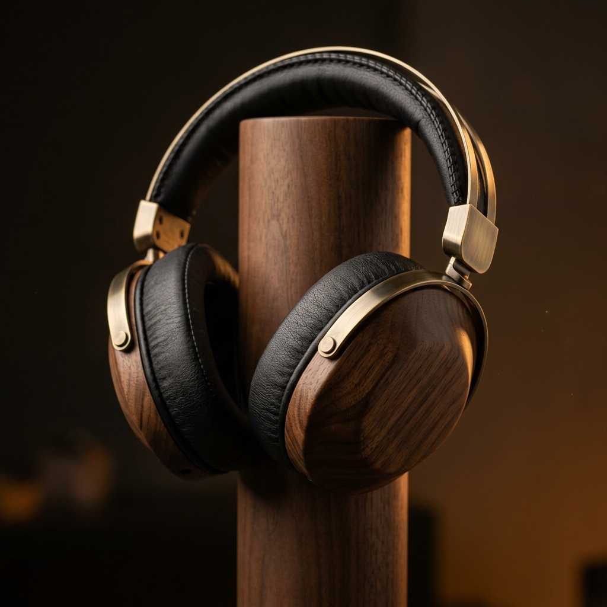
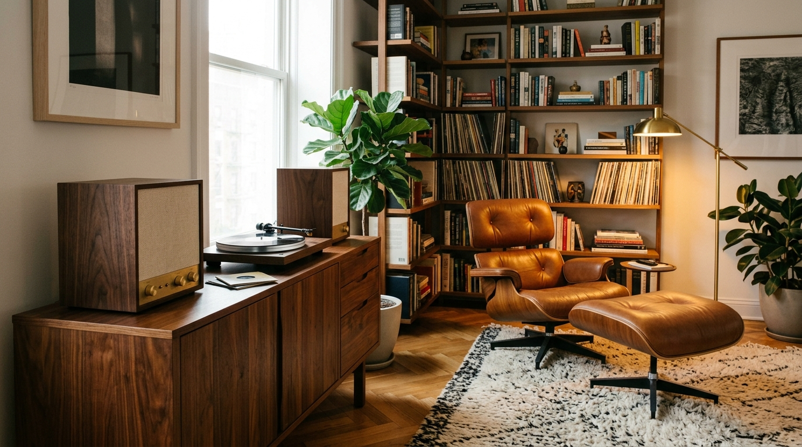
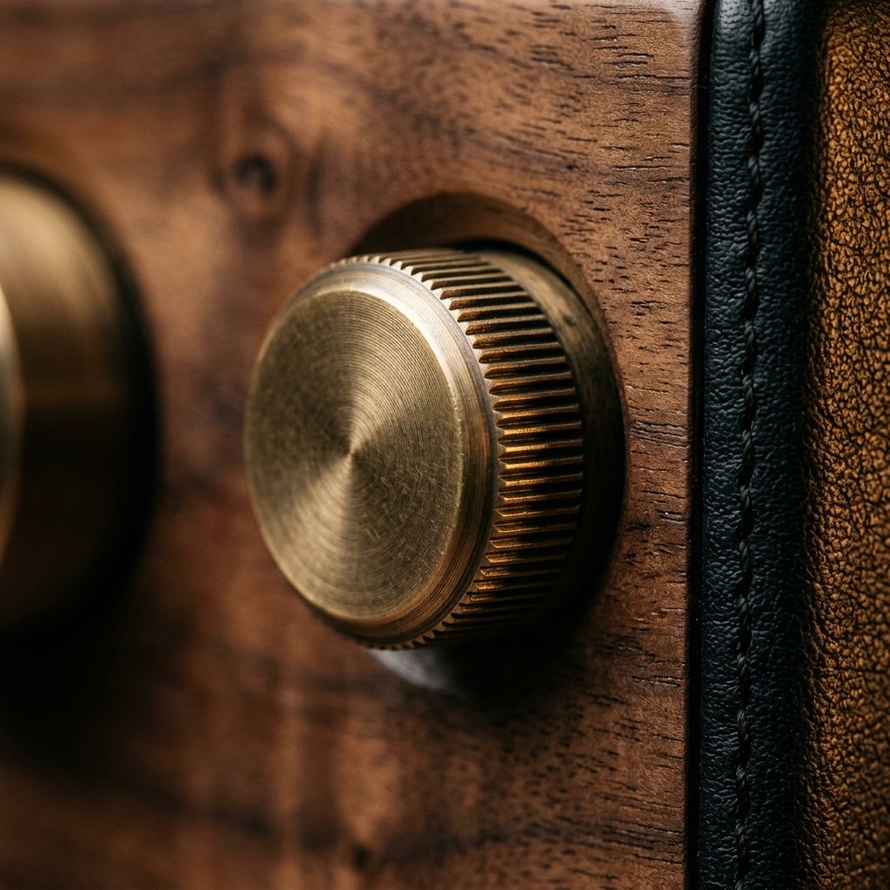
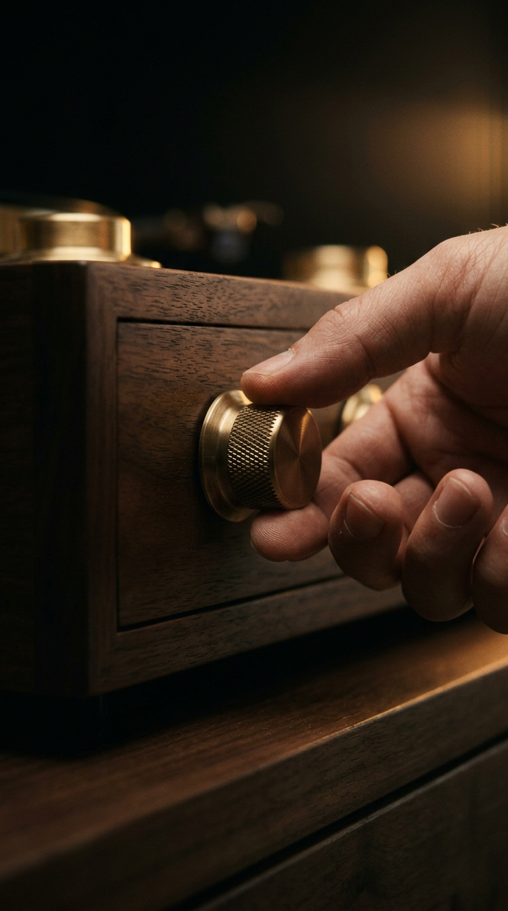

# EchoCraft Audio: Yapay Zeka Destekli Uçtan Uca Marka İçerik Üretim Sistemi
## *AI-Powered End-to-End Brand Content Generation System*

> **"Analog Ruhu, Zamansız Ses"** / **"Analog Soul, Timeless Sound"**  
> *CONTENTFLOW: Yapay Zeka ile İçerik Üretimi Eğitimi — Final Projesi / AI Content Creation Final Project*

<p align="center">
  <a href="https://canva.link/yb6kgk17kdfdl7r">
    
  </a>
  
  
  
  
</p>

---

## 🌐 Dil Seçimi / Language Navigation
- [🇹🇷 Türkçe Dokümantasyon](#-türkçe-proje-dokümantasyonu)
- [🇬🇧 English Documentation](#-english-project-documentation)

---

## 📸 Görsel Vitrini / Visual Asset Showcase

<table align="center" width="100%">
  <tr>
    <td align="center" width="50%">
      <br/>
      <b>Şekil 1 / Figure 1:</b> <i>EchoCraft Heritage Masif Ceviz & Pirinç Kulaklık (1:1)</i><br/>
      <sub>Solid Walnut & Brushed Brass Headphones</sub>
    </td>
    <td align="center" width="50%">
      <br/>
      <b>Şekil 2 / Figure 2:</b> <i>Akustik Dinleme Köşesi Blog Kapağı (16:9)</i><br/>
      <sub>Acoustic Listening Nook Blog Banner</sub>
    </td>
  </tr>
  <tr>
    <td align="center" width="50%">
      <br/>
      <b>Şekil 3 / Figure 3:</b> <i>Fırçalanmış Pirinç Ses Kadranı Zanaat Makrosu (1:1)</i><br/>
      <sub>Tactile Knurled Brass Volume Knob Macro</sub>
    </td>
    <td align="center" width="50%">
      <br/>
      <b>Şekil 4 / Figure 4:</b> <i>Video Sahne 2 Başlangıç Karesi (9:16)</i><br/>
      <sub>Turning Volume Knob Video Keyframe</sub>
    </td>
  </tr>
</table>

---

# 🇹🇷 TÜRKÇE PROJE DOKÜMANTASYONU

## 1. Proje Özeti
Bu proje; lüks analog ses donanımları markası **EchoCraft Audio** için sıfırdan marka kimliği inşası, hedef kitle personası, 7 günlük çok kanallı içerik takvimi ve bu takvime ait çok formatlı (SEO blog yazısı, sosyal medya, 8K görsel, dikey video ve TTS seslendirme) içeriklerin yapay zeka araçlarıyla uçtan uca üretilmesini ve belgelenmesini kapsar.

* **Öğrenci:** Rıdvan Efe Birben
* **Eğitmen:** Musa Kolcuk
* **Tarih:** Ekim 2026
* **Canva Sunumu:** [EchoCraft Audio Okuma Deck'i (28 Slayt)](https://canva.link/yb6kgk17kdfdl7r)

---

## 2. Marka Kimliği & Renk Paleti (Aşama 01)
* **Koyu Ceviz (Masif Ahşap):** `#2C1B14`
* **Antik Fırçalanmış Pirinç:** `#C5A059`
* **Deri Siyahı (Obsidiyen):** `#161616`
* **Keten Krem (Akustik Kumaş):** `#F4EFEA`
* **Amber Parıltısı (Tüp Lamba Sıcaklığı):** `#E07A5F`
* **Temel Değerler:** Akustik Dürüstlük, Zanaatkarlık (Craftsmanship), Dokunsal Deneyim.

---

## 3. Stratejik Çerçeve & Persona (Aşama 02)
* **Neden (Why):** Müzik dinlemeyi arka plan gürültüsü tüketmekten çıkarıp dokunsal bir ritüele dönüştürmek.
* **Kime (Who):** Dijital yüzeysellikten yorulmuş, analog ses derinliği arayan şehirli yaratıcı profesyoneller.
* **Ne (What):** Masif ceviz kabinli hoparlörler ve 40mm dinamik titanyum sürücülü el yapımı kulaklıklar.
* **Nasıl (How):** Geleneksel akustik zanaatını modern kayıpsız Bluetooth teknolojisiyle harmanlayarak.
* **Hedef Persona:** Emre Yalçın (34, İstanbul/Kadıköy) — Mimar & Plak Koleksiyoncusu.
* **Yeşil Liste (Zorunlu Terimler):** *Akustik sıcaklık, analog tını, rezonans, el işçiliği, tını derinliği, harmonik zenginlik, zamansız tasarım, pirinç ses kadranı, sahne genişliği.*
* **Kırmızı Liste (Yasaklı Klişeler):** *Kulağı patlatan bas, devrimsel, mucizevi, sihirli, süper ucuz, yüzde yüz garanti, şok fiyat, teknolojik canavar.*

---

## 4. 7 Günlük İçerik Takvimi (Aşama 03)

| Gün | Kanal | Sütun | Format | Başlık / Konu |
| :--- | :--- | :--- | :--- | :--- |
| **Pzt** | Instagram & LinkedIn | [Eğitici] | 4 Slaytlık Carousel | *Dijital Çağda Kaybolan Tını: Neden Analog Sıcaklığı Arıyoruz?* |
| **Sal** | Instagram | [Topluluk] | Story / Anket | *Sizin Odaklanma Albümünüz Hangisi?* |
| **Çar** | Web / Blog | [Eğitici] | SEO Uyumlu Blog | *Evde Mükemmel Akustik Köşe Oluşturma Rehberi: Odanızın Sesini Keşfedin* |
| **Per** | LinkedIn & X | [İlham & Vaka] | Tekil Görsel + Metin | *1959, New York: 30. Cadde Stüdyoları ve Kind of Blue Akustiği* |
| **Cum** | Reels & Shorts | [İlham & Ürün] | 23 sn Dikey Video (9:16) | *Bir Plağın İlk Çıtırtısı: EchoCraft Heritage Serisi* |
| **Cmt** | Instagram | [Ürün & Zanaat] | Makro Görsel + Metin | *Fırçalanmış Pirinç ve Yıllandırılmış Ceviz: Dokunarak Duyulan Ses* |
| **Paz** | Instagram & Spotify | [Topluluk] | TTS Ses Kaydı | *Pazar Dinleme Kulübü: Akustik Mola* |

---

## 5. Multimedya Varlıkları (Video & Ses)
* **TTS Ses Kaydı:** `assets/audio/echocraft_tanitim_seslendirmesi.mp3` (ElevenLabs Multilingual v2, "Adam" Derin Bariton Ses, %45 Kararlılık, 23 saniye).
* **Tanıtım Videosu:** Kling AI Pro motoru ile 9:16 dikey formatta üretilen 4 sinematik sahne kurgusu:
  - *00:00–00:03:* Siyah Ekran & Dış Ses (Görsel dikkati sıfırlayan sinematik kanca)
  - *00:03–00:08:* Sahne 1 — Pikap İğnesi & Vinil Oluk
  - *00:08–00:13:* Sahne 2 — Masif Ahşap Panelde Pirinç Kadran
  - *00:13–00:18:* Sahne 3 — Dinleme Koltuğu & Müzik Seansı
  - *00:18–00:23:* Sahne 4 — Ahşap Stand Üzerinde Kulaklık & CTA Kapanışı

---

## 6. Sorumlu Kullanım ve Süreç Şeffaflığı (Aşama 04)
* **Telif Güvencesi:** Tüm görseller ve metinler sıfırdan yapay zeka ile üretilmiştir; patentli ticari marka ihlali veya stok görsel içermez.
* **Halüsinasyon Denetimi:** 1959 Columbia Records 30. Cadde Kilise stüdyosu akustiği ve oda eşkenar üçgen fiziği doğrulanmıştır.
* **Tasarım İterasyonları (İnsan Denetimi):**
  - *Jargon:* "Potansiyometre" yerine tüketici dilinde "pirinç ses ayar düğmesi" kullanıldı.
  - *Logosuz Lüks:* Kulaklık üzerine yapay oyma logo eklemek yerine saf ahşap ve pirinç zanaatına odaklanıldı.
  - *Video Motoru:* Statik yakınlaştırma yerine Kling AI ile gerçek parmak ve ışık fiziği elde edildi.

---

# 🇬🇧 ENGLISH PROJECT DOCUMENTATION

## 1. Project Overview
This repository documents an end-to-end, AI-powered brand content production system designed for **EchoCraft Audio**, a luxury analog-modern audio hardware brand. The project covers brand positioning, target persona design, a 7-day multi-channel content calendar, and multimedia asset generation (SEO blog post, social media campaigns, 8K generative imagery, 9:16 vertical video, and TTS voiceover).

* **Author:** Rıdvan Efe Birben
* **Instructor:** Musa Kolcuk
* **Date:** October 2026
* **Canva Presentation:** [EchoCraft Audio Standalone Reading Deck (28 Slides)](https://canva.link/yb6kgk17kdfdl7r)

---

## 2. Brand Identity & Color Palette (Phase 01)
* **Dark Walnut (Solid Wood):** `#2C1B14`
* **Antique Brushed Brass:** `#C5A059`
* **Obsidian Leather Black:** `#161616`
* **Linen Acoustic Cream:** `#F4EFEA`
* **Amber Glow (Vacuum Tube Warmth):** `#E07A5F`
* **Core Brand Values:** Acoustic Integrity, Handcrafted Artistry (Craftsmanship), Tactile Rituals.

---

## 3. Strategic Framework & Persona (Phase 02)
* **Why:** To transform listening from background noise consumption into a grounding, tactile ritual.
* **Who:** Discerning creative professionals exhausted by digital shallowness, seeking analog depth.
* **What:** Handcrafted walnut acoustic speakers and 40mm titanium driver wireless Hi-Fi headphones.
* **How:** Blending traditional woodworking craftsmanship with lossless low-latency wireless streaming.
* **Target Persona:** Emre Yalçın (34, Istanbul) — Architect & Vinyl Collector.
* **Green List (Mandatory Terms):** *Acoustic warmth, analog timbre, resonance, craftsmanship, soundstage, harmonic richness, timeless design, brass dial.*
* **Red List (Prohibited Clichés):** *Earth-shattering bass, revolutionary, miraculous, magical, super cheap, 100% guaranteed, shock price, tech beast.*

---

## 4. 7-Day Multi-Channel Content Calendar (Phase 03)

| Day | Channel | Pillar | Format | Content Title |
| :--- | :--- | :--- | :--- | :--- |
| **Mon** | Instagram & LinkedIn | [Educational] | 4-Card Carousel | *Lost Timbre in the Digital Age: Why We Seek Analog Warmth* |
| **Tue** | Instagram | [Community] | Story / Poll | *What Is Your Ultimate Focus Album?* |
| **Wed** | Web / Blog | [Educational] | SEO Long-Form Blog | *Guide to Crafting the Perfect Acoustic Nook at Home* |
| **Thu** | LinkedIn & X | [Inspiration & Case] | Single Post + Visual | *1959, New York: 30th Street Studios and the Acoustics of Kind of Blue* |
| **Fri** | Reels & Shorts | [Inspiration & Product]| 23s Vertical Video (9:16) | *The First Needle Drop: EchoCraft Heritage Series* |
| **Sat** | Instagram | [Product & Craft] | Macro Visual + Caption | *Brushed Brass & Aged Walnut: Sound You Can Touch* |
| **Sun** | Instagram & Spotify | [Community] | Audio Track (TTS) | *Sunday Listening Club: Acoustic Respite* |

---

## 5. Prompt Engineering Methodology

### A. CO-STAR Framework (SEO Blog Post)
* **Context:** Senior acoustic consultant for a bespoke luxury audio brand.
* **Objective:** Comprehensive educational and SEO guide to setting up a home listening nook.
* **Style:** Kinfolk / Monocle editorial lifestyle aesthetic.
* **Tone:** Warm, authoritative, artisan master voice.
* **Audience:** 25–45 year old architects, designers, and audiophiles.
* **Response:** H1, strict 146-character meta description, H2-H3 hierarchy, and organic CTA.

### B. RTF Formula (Social Media Posts)
* **Role:** Luxury Hardware & Industrial Design Editor.
* **Task:** Sensory copywriting highlighting knurled brass controls and tactile aged walnut wood.
* **Format:** Hook + Value Body + Engagement Question + 5 Niche Hashtags.

### C. 6-Layer Generative Image Prompt Anatomy
1. **Subject:** High-end luxury over-ear headphones, dark walnut earcups, brushed brass hardware.
2. **Environment:** Minimalist solid wooden pedestal in an intimate studio.
3. **Lighting:** 2700K warm amber raking side light, soft golden rim illumination.
4. **Camera:** 85mm f/2.0 portrait lens, 100mm macro lens, shallow depth of field.
5. **Style & Texture:** Hyper-tactile wood grain, lathe-turned micro-ridges, photorealistic 8K.
6. **Parameters:** `--ar 1:1 --v 6.0 --style raw`

---

## 6. Multimedia Assets & Production Evidence
* **TTS Voiceover:** `assets/audio/echocraft_tanitim_seslendirmesi.mp3` (ElevenLabs Multilingual v2, "Adam" Deep Baritone Voice, 45% Stability, 23 seconds).
* **Cinematic Video:** Kling AI Pro 9:16 vertical short commercial with intentional 3-second black screen sensory hook.
* **Visual Gallery:** All four 8K photorealistic assets located in `assets/images/`.

---

## 📂 Repository Structure

```text
echocraft-audio/
├── assets/
│   ├── images/
│   │   ├── echocraft_heritage_kulaklik.jpg        # Figure 1: Heritage Headphones (1:1)
│   │   ├── echocraft_listening_nook_blog_cover.jpg # Figure 2: Listening Nook Blog Cover (16:9)
│   │   ├── echocraft_brass_knob_macro.jpg         # Figure 3: Knurled Brass Knob Macro (1:1)
│   │   └── echocraft_donen_kadran_sahne2.jpg      # Figure 4: Video Scene 2 Keyframe (9:16)
│   └── audio/
│       └── echocraft_tanitim_seslendirmesi.mp3    # ElevenLabs 23s Audio Track
├── docs/
│   ├── marka_stratejisi.md                        # Brand Strategy & Positioning
│   ├── icerik_takvimi.md                          # 7-Day Multi-Channel Calendar
│   └── kalite_kontrol_ve_ai_raporu.md             # Quality Assurance & Transparency Report
├── prompts/
│   └── prompt_kutuphanesi.md                      # CO-STAR, RTF & 6-Layer Prompts
└── README.md                                      # Bilingual Showcase & Portfolio Documentation
```

---

## 📜 Academic Integrity & License
Created as the final capstone project for **CONTENTFLOW: AI Content Production Training (October 2026)** under the instruction of Musa Kolcuk. All generative prompts and deliverables are protected under educational creative licenses.
